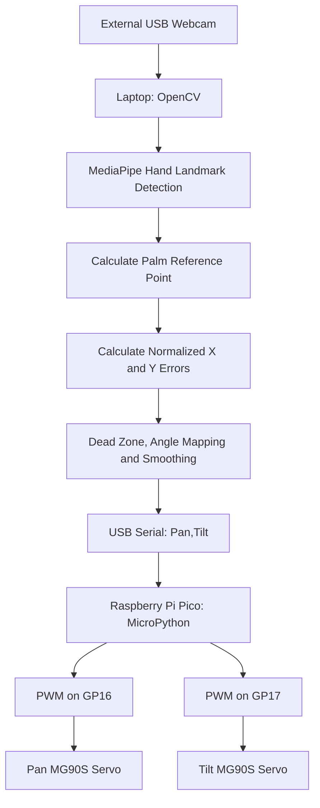

# Real-Time Hand Tracking and Two-Axis Pan-Tilt Control System

A computer-vision-based pan-and-tilt prototype that detects a hand with a webcam, estimates its position in the camera frame, and converts that position into movement commands for two MG90S servo motors. A laptop runs Python, OpenCV, and MediaPipe; a Raspberry Pi Pico runs MicroPython and controls the servos over USB serial.

> **Project status:** Working prototype using MediaPipe hand landmarks and 2D image-coordinate mapping. Depth estimation, camera-to-pivot parallax compensation, YOLO object detection, and closed-loop position feedback are future improvements—not features of the current implementation.

> **Safety:** Use a diffused LED indicator or a non-emitting pointer for demonstrations. Do not attach or operate an automatically aimed laser. Tracking errors, unexpected movement, or software faults can direct a laser beam toward someone's eyes. The project demonstrates the same pan-and-tilt control principles without an active laser.

---

## Table of Contents

- [1. Overview](#1-overview)
- [2. Features](#2-features)
- [3. How It Works](#3-how-it-works)
- [4. Hardware Requirements](#4-hardware-requirements)
- [5. Wiring](#5-wiring)
- [6. Software Requirements](#6-software-requirements)
- [7. Repository Structure](#7-repository-structure)
- [8. Setup on Windows](#8-setup-on-windows)
- [9. Programming the Raspberry Pi Pico](#9-programming-the-raspberry-pi-pico)
- [10. Running the Hand Tracker](#10-running-the-hand-tracker)
- [11. Configuration and Calibration](#11-configuration-and-calibration)
- [12. Mathematics and Tracking Logic](#12-mathematics-and-tracking-logic)
- [13. Serial Communication Protocol](#13-serial-communication-protocol)
- [14. Testing Procedure](#14-testing-procedure)
- [15. Troubleshooting](#15-troubleshooting)
- [16. Current Limitations](#16-current-limitations)
- [17. Future Improvements](#17-future-improvements)
- [18. Acknowledgements and References](#18-acknowledgements-and-references)

---

## 1. Overview

The project combines computer vision, image processing, serial communication, embedded programming, and servo control.

A USB webcam remains stationary and continuously captures the user's hand. MediaPipe estimates 21 landmarks on the detected hand. The application uses landmarks near the base of the index finger and little finger to estimate a palm reference point. It compares that point with the centre of the camera image and maps the resulting horizontal and vertical offsets to pan and tilt servo angles.

The laptop sends the two angle commands to the Raspberry Pi Pico through USB serial. The Pico parses the commands and generates 50 Hz PWM signals for the two MG90S servos.

### Project objectives

1. Capture a live video stream from an external webcam.
2. Detect one hand and estimate its landmarks in real time.
3. Calculate a stable reference point on the palm.
4. Determine the hand's horizontal and vertical displacement from the image centre.
5. Map the displacement to pan and tilt servo commands.
6. Send commands from the laptop to the Pico using USB serial communication.
7. Control two MG90S servo motors using MicroPython PWM.
8. Reduce unwanted movement with a dead zone, smoothing, and angle limits.
9. Display the camera feed, hand landmarks, palm marker, and commanded angles on the laptop.

### Intended use

This is an educational prototype for exploring vision-guided motion and human-computer interaction. It is suitable for a controlled demonstration area at a known or approximately fixed distance. It is not a safety-critical tracking device or a calibrated 3D pointing system.

---

## 2. Features

- **Live webcam preview:** Displays the external camera feed in an OpenCV window.
- **Hand landmark detection:** Uses MediaPipe Hands to estimate 21 landmarks for one hand.
- **Palm reference point:** Estimates the palm position from landmarks 5 and 17.
- **Two-axis mapping:** Converts image-space horizontal and vertical offsets into pan and tilt angle targets.
- **USB serial control:** Sends paired pan and tilt values to the Raspberry Pi Pico.
- **MicroPython firmware:** The Pico independently handles servo PWM generation.
- **Movement limiting:** Restricts requested angles to a configurable range.
- **Dead-zone filtering:** Ignores small movements near the image centre.
- **Exponential smoothing:** Gradually moves commands toward the latest target to reduce jitter.
- **Centre on hand loss:** After a short period without a detected hand, the application gradually returns the servos to the centre.

---

## 3. How It Works

### System architecture



### Processing sequence

1. Open the external webcam and the Pico's serial port.
2. Capture a video frame using OpenCV.
3. Convert the frame from BGR to RGB for the MediaPipe Hands API.
4. Process the frame and check whether a hand has been detected.
5. Read the normalized coordinates of landmarks 5 and 17.
6. Calculate the palm reference point and its offset from the image centre.
7. Normalize the horizontal and vertical errors.
8. Apply a dead zone to suppress very small changes.
9. Map the remaining errors to target pan and tilt angles.
10. Clamp the target angles to the allowed range and apply smoothing.
11. Send the updated pan and tilt values to the Pico.
12. Display the annotated frame and tracking information.
13. If no hand is detected for more than the configured timeout, gradually return to the centre.

### Live display

The laptop window shows:

- The live webcam image.
- MediaPipe's hand skeleton and landmarks.
- A crosshair at the image centre.
- A marker at the estimated palm reference point.
- A line between the image centre and the palm point.
- The current commanded pan and tilt angles.

The camera is stationary. The preview therefore shows the hand's position in the fixed camera image; it does not move with the servo assembly.

---

## 4. Hardware Requirements

| Component | Quantity | Purpose |
|---|---:|---|
| Raspberry Pi Pico (RP2040) | 1 | Embedded controller for the servos |
| MG90S metal-geared servo | 2 | Horizontal pan and vertical tilt |
| Two-axis pan-and-tilt bracket | 1 | Mechanical mounting for the servos and indicator |
| External USB webcam | 1 | Captures the hand video |
| Laptop or desktop PC | 1 | Runs computer vision and serial-control software |
| Regulated 5 V power supply | 1 | Supplies the servo motors |
| Jumper wires | As required | Electrical connections |
| Breadboard or suitable distribution wiring | As required | Prototyping connections |
| Diffused LED indicator (recommended) | 1 | Safe visual indicator for the mechanism |

### Power considerations

The two servos should be powered from a separate regulated 5 V supply with sufficient current capacity. A supply rated around 2 A is a reasonable starting point for two small servos, but actual current demand depends on the load, acceleration, and whether a servo is stalled.

- Do not power the servos from the Pico's 3.3 V output.
- Do not draw servo motor current through a Pico GPIO pin.
- Connect the external supply ground to a Pico GND pin so the PWM signals share a common reference.
- Use suitable wiring and a secure power connection. Avoid relying on weak breadboard contacts for high servo currents.
- Disconnect power immediately if a servo stalls, strains, overheats, or presses against a mechanical stop.

---

## 5. Wiring

### Servo signal connections

| Servo | Pico GPIO | Physical Pico pin | Function |
|---|---:|---:|---|
| Pan MG90S signal | GP16 | 21 | Horizontal movement |
| Tilt MG90S signal | GP17 | 22 | Vertical movement |

### Servo power connections

| Servo wire | Connection |
|---|---|
| Red | External regulated +5 V |
| Brown/black | External supply GND |
| Orange/yellow/white | Corresponding Pico GPIO signal |

Both servo grounds must connect to the external supply ground. Connect that ground to Pico GND as well. The servos' red wires connect to the external 5 V supply, not to the Pico's 3.3 V pin.

### Other hardware

- Connect the webcam to the laptop through USB.
- Connect the Pico to the laptop through USB. This provides the serial data connection and powers the Pico itself.
- Mount the webcam below the pan-and-tilt mechanism, as in the prototype. Keep it fixed during the initial 2D mapping tests.

> **Pin-number reminder:** Physical pin 21 is GP16, and physical pin 22 is GP17. Physical pin numbers and GPIO numbers are not interchangeable.

---

## 6. Software Requirements

| Software / Library | Purpose |
|---|---|
| Python 3.11 (64-bit recommended) | Runs the laptop application |
| OpenCV (`opencv-python`) | Webcam capture, image conversion, drawing, and display |
| MediaPipe (`mediapipe`) | Hand detection and landmark estimation |
| NumPy | Numerical operations and array support used by the vision stack |
| PySerial (`pyserial`) | USB serial communication with the Pico |
| MicroPython | Runs the servo-control firmware on the Pico |
| `mpremote` | Uploads and manages files on the Pico |
| Visual Studio Code | Source-code editor and terminal |

The laptop and Pico use separate Python environments:

- **Laptop:** Standard desktop Python with OpenCV, MediaPipe, NumPy, PySerial, and `mpremote`.
- **Pico:** MicroPython firmware with built-in modules such as `machine` and `sys`.

Do not try to install desktop OpenCV or MediaPipe on the Pico. They run on the laptop.

---

## 7. Repository Structure

A suggested repository layout is:

```text
HandTrackingTurret/
│
├── README.md
├── requirements.txt
├── .gitignore
│
├── laptop/
│   └── hand_tracker.py
│
├── pico/
│   └── pico_servo.py
│
├── docs/
│   ├── images/
│   │   ├── hardware-prototype.jpg
│   │   ├── hand-tracking-window.png
│   │   └── wiring-diagram.png
│   ├── block-diagram.png
│   └── flowchart.png
│
└── tests/
    └── servo_test.py
```

The exact directory structure can differ. If the scripts are kept in the repository root, update the paths in the commands below accordingly.

### File descriptions

- `laptop/hand_tracker.py`: Captures webcam frames, detects the hand, calculates target angles, and sends serial commands.
- `pico/pico_servo.py`: Runs on the Pico; parses angle commands and updates the two PWM outputs.
- `tests/servo_test.py`: Optional standalone test for checking the servo directions and travel before running computer vision.
- `requirements.txt`: Lists the laptop-side Python dependencies.
- `docs/`: Stores original photographs, diagrams, and screenshots for the project documentation.

---

## 8. Setup on Windows

The instructions below use Windows PowerShell in the VS Code integrated terminal.

### 8.1 Install prerequisites

Install:

1. [Python 3.11](https://www.python.org/downloads/) (64-bit recommended for the pinned MediaPipe version).
2. [Visual Studio Code](https://code.visualstudio.com/).
3. The Microsoft Python extension for VS Code.
4. A USB data cable suitable for the Raspberry Pi Pico.

Check Python from the VS Code terminal:

```powershell
py -3.11 --version
```

### 8.2 Create a virtual environment

Open the project directory in VS Code and create a virtual environment:

```powershell
py -3.11 -m venv .venv
```

Activate it:

```powershell
.\.venv\Scripts\Activate.ps1
```

The terminal prompt should show `(.venv)` when the environment is active.

If PowerShell prevents script activation, use Command Prompt as the VS Code terminal and run:

```bat
.venv\Scripts\activate.bat
```

### 8.3 Install dependencies

Create `requirements.txt` containing:

```text
opencv-python
mediapipe==0.10.21
numpy<2
pyserial
mpremote
```

Install the packages:

```powershell
python -m pip install --upgrade pip
python -m pip install -r requirements.txt
```

Check that the packages import correctly:

```powershell
python -c "import cv2, mediapipe, numpy, serial; print('OpenCV:', cv2.__version__); print('MediaPipe:', mediapipe.__version__); print('NumPy:', numpy.__version__); print('PySerial: OK')"
```

### 8.4 Select the VS Code interpreter

In VS Code:

1. Press `Ctrl+Shift+P`.
2. Search for **Python: Select Interpreter**.
3. Select the interpreter inside the project's `.venv` folder.
4. Open a new terminal and activate the environment if required.

---

## 9. Programming the Raspberry Pi Pico

### 9.1 Install MicroPython firmware (first-time setup only)

If the Pico already runs MicroPython, skip this section.

1. Disconnect the Pico from USB.
2. Hold the Pico's **BOOTSEL** button while connecting it to the computer.
3. Release BOOTSEL. A USB drive named `RPI-RP2` should appear.
4. Download the MicroPython UF2 firmware for the exact board model from the [MicroPython Raspberry Pi Pico downloads page](https://micropython.org/download/RPI_PICO/).
5. Copy the UF2 file to the `RPI-RP2` drive.
6. The Pico restarts and the drive disappears. This is expected.

### 9.2 Find the Pico COM port

Connect the Pico normally and run:

```powershell
mpremote connect list
```

Alternatively, open Windows Device Manager and look under **Ports (COM & LPT)**. The port might be `COM3`, `COM4`, or another number.

Use the actual port shown on your system in all commands below.

### 9.3 Upload the Pico program

The Pico source file is named `pico_servo.py` on the computer. It must be uploaded to the Pico as `main.py` so MicroPython executes it at startup.

If the source file is inside the `pico` folder:

```powershell
mpremote connect COM3 fs cp pico/pico_servo.py :main.py
```

If it is in the repository root:

```powershell
mpremote connect COM3 fs cp pico_servo.py :main.py
```

Restart the Pico:

```powershell
mpremote connect COM3 reset
```

After reset, the Pico initializes both servos at their centre position and waits for incoming serial commands.

> Close Thonny, other serial monitors, and any existing `mpremote repl` session before starting the laptop program. A serial port is normally held by one application at a time.

---

## 10. Running the Hand Tracker

### 10.1 Configure the laptop program

Open `hand_tracker.py` and check these settings near the top:

```python
PORT = "COM3"       # Replace with the Pico's actual COM port
CAMERA_INDEX = 1    # Replace with the external webcam's index
```

The external webcam index is not guaranteed to be `1` on every computer. Use the index that worked in your camera test. If the webcam does not open, close Windows Camera, Teams, Zoom, or other applications currently using it.

The program uses the DirectShow backend on Windows:

```python
cap = cv2.VideoCapture(CAMERA_INDEX, cv2.CAP_DSHOW)
```

### 10.2 Start the Pico firmware

If the Pico program has already been uploaded, reset the Pico when needed:

```powershell
mpremote connect COM3 reset
```

Wait for the reset command to complete, then do not leave an `mpremote repl` session open.

### 10.3 Run the laptop application

Activate the environment:

```powershell
.\.venv\Scripts\Activate.ps1
```

If the script is inside `laptop`:

```powershell
python laptop/hand_tracker.py
```

If the script is in the repository root:

```powershell
python hand_tracker.py
```

A window named **Hand Tracking Turret** should appear. It displays the live camera view and the hand-tracking annotations.

Move your hand inside the camera's field of view and observe the displayed palm marker and commanded pan/tilt angles. Press **Q** while the OpenCV window is active to exit. The program attempts to send the centre command before closing the serial connection.

### Normal startup sequence

After the first setup and upload, normal use is:

1. Connect the webcam and Pico.
2. Power the servos from the external regulated 5 V supply, with common ground connected.
3. Open the project in VS Code.
4. Activate `.venv`.
5. Reset the Pico if it is not already running the firmware.
6. Run the laptop tracking script.

The Pico firmware only needs to be uploaded again when `pico_servo.py` changes.

---

## 11. Configuration and Calibration

The initial mapping must be adjusted to the camera, servo orientation, bracket, and working area. Values below describe the current prototype configuration; they are not universal calibration constants.

| Parameter | Current value | Purpose |
|---|---:|---|
| `CAMERA_INDEX` | `1` (example) | Selects the external webcam; verify on each PC |
| `PAN_CENTER` | `90` degrees | Nominal horizontal centre |
| `TILT_CENTER` | `90` degrees | Nominal vertical centre |
| `PAN_RANGE` | `35` degrees | Horizontal mapping gain/range |
| `TILT_RANGE` | `30` degrees | Vertical mapping gain/range |
| `PAN_SIGN` | `1` | Reverses horizontal direction when set to `-1` |
| `TILT_SIGN` | `1` | Reverses vertical direction when set to `-1` |
| `MIN_ANGLE` | `45` degrees | Software lower movement limit |
| `MAX_ANGLE` | `135` degrees | Software upper movement limit |
| `DEAD_ZONE` | `0.035` | Ignores small normalized position errors |
| `SMOOTHING` | `0.20` | Exponential smoothing factor |
| Hand-loss timeout | `1.0` second | Time before gradual return to centre |
| Serial baud rate | `115200` | Laptop-to-Pico communication speed |
| PWM frequency | `50` Hz | Servo control signal frequency |

### 11.1 Centre alignment

1. Place the mechanism on a stable surface.
2. Ensure the camera is firmly mounted and not moving.
3. Start both servos at their nominal 90-degree positions.
4. Align the mechanism's neutral indicator direction with the centre of the intended working area.
5. Place the hand near the centre of the webcam image and confirm that the mechanism remains near its neutral position.

If the mechanism's neutral orientation does not correspond to the camera frame centre, adjust the physical alignment or add a measured centre offset in software.

### 11.2 Direction calibration

Move the hand in one direction at a time:

| Hand movement in the preview | Expected command change |
|---|---|
| Right | Pan command increases with `PAN_SIGN = 1` |
| Left | Pan command decreases with `PAN_SIGN = 1` |
| Up | Tilt command increases with `TILT_SIGN = 1` |
| Down | Tilt command decreases with `TILT_SIGN = 1` |

The physical direction depends on how the servos and bracket are assembled. If an axis moves in the opposite direction, change its sign from `1` to `-1`. Test one axis at a time.

### 11.3 Sensitivity

Increase `PAN_RANGE` or `TILT_RANGE` to make the corresponding servo command change more for the same image displacement. Decrease them for less sensitivity. Keep the resulting target angles within the actual safe mechanical travel of the assembly.

### 11.4 Smoothing and dead zone

- Lower `SMOOTHING` for slower, smoother response.
- Raise `SMOOTHING` for faster response, with potentially more jitter.
- Raise `DEAD_ZONE` to ignore more small movements around the image centre.
- Lower `DEAD_ZONE` to make the mechanism respond to smaller displacements.

### 11.5 Fixed-distance working area

The initial implementation maps two-dimensional image coordinates to servo angles. For the most repeatable initial demonstration, keep the hand within a defined working area and at an approximately fixed distance from the camera. Moving the hand substantially closer or farther away changes the geometry and can cause pointing offset.

The webcam is mounted below the pan-and-tilt pivot. This physical separation introduces parallax. The current code does not calculate a calibrated 3D target position or compensate fully for this offset.

---

## 12. Mathematics and Tracking Logic

### 12.1 Palm reference point

MediaPipe returns normalized hand landmark coordinates. The current implementation uses landmarks 5 and 17:

\[
X_h = \frac{x_5+x_{17}}{2}, \qquad
Y_h = \frac{y_5+y_{17}}{2}
\]

These values are normalized relative to the image dimensions.

### 12.2 Image centre

For a frame of width \(W\) and height \(H\):

\[
C_x = \frac{W}{2}, \qquad C_y = \frac{H}{2}
\]

### 12.3 Normalized position errors

The laptop application maps the palm position to normalized errors:

\[
e_x = \frac{X_{pixel}-C_x}{W/2}
\]

\[
e_y = \frac{C_y-Y_{pixel}}{H/2}
\]

The vertical error is inverted because image Y coordinates increase downwards.

### 12.4 Servo-angle mapping

The current prototype uses a centre angle of 90 degrees and configurable mapping ranges:

\[
\theta_{pan,target}=90+s_x K_x e_x
\]

\[
\theta_{tilt,target}=90+s_y K_y e_y
\]

Where:

- \(K_x\) is the horizontal mapping range (currently 35 degrees).
- \(K_y\) is the vertical mapping range (currently 30 degrees).
- \(s_x\) and \(s_y\) are direction signs, each set to either +1 or -1.
- \(e_x\) and \(e_y\) are normalized image-position errors.

The target values are constrained by the configured minimum and maximum angles before being smoothed and sent to the Pico.

### 12.5 Dead-zone function

For a normalized error \(e\) and dead-zone threshold \(d\):

\[
e' =
\begin{cases}
0, & |e| < d \\
e, & |e| \geq d
\end{cases}
\]

This prevents very small changes around the image centre from constantly adjusting the servos.

### 12.6 Exponential smoothing

The current program applies first-order exponential smoothing:

\[
\theta_t = \theta_{t-1} + \alpha(\theta_{target}-\theta_{t-1})
\]

Where \(\alpha=0.20\) in the current configuration. This reduces abrupt command changes but introduces some response delay.

### 12.7 PWM signal

The Pico generates a 50 Hz PWM signal. Its period is:

\[
T=\frac{1}{50}=0.02\text{ s}=20\text{ ms}
\]

The current Pico program uses an approximate pulse-width mapping:

\[
P_{\mu s}=1000+\frac{\theta}{180}\times1000
\]

For example, a nominal 90-degree command corresponds to an approximately 1500 microsecond pulse. Servo units differ, so the pulse range should be calibrated carefully and must not force the mechanism against a mechanical stop.

---

## 13. Serial Communication Protocol

The serial protocol is intentionally simple: one text line contains two comma-separated integer values, followed by a newline.

**Format:**

```text
pan_angle,tilt_angle\n
```

**Examples:**

```text
90,90
105,90
105,110
```

The laptop sends a line using PySerial. The Pico reads a line from its USB serial standard input, removes whitespace, splits at the comma, converts both fields to integers, constrains the angles, and updates the PWM outputs.

### Communication settings

| Setting | Value |
|---|---|
| Connection | USB serial |
| Windows port | Configurable, e.g. `COM3` |
| Baud rate | `115200` |
| Data format | Two comma-separated integers |
| Message delimiter | Newline (`\n`) |

The COM port must be changed to match the port assigned by Windows. Close other applications that may be using the Pico's serial port before starting the tracker.

---

## 14. Testing Procedure

Test individual components before running the integrated system.

### 14.1 Webcam test

- Close the Windows Camera app and other applications that may be using the webcam.
- Run a separate OpenCV camera test.
- Confirm that the external camera index is correct and that live frames appear.

### 14.2 Hand detection test

- Run MediaPipe hand detection without connecting to the Pico.
- Confirm that the hand skeleton and landmarks appear.
- Check that the hand remains detected when moved slowly across the camera view.

### 14.3 Servo test

- Test the pan and tilt servos independently.
- Verify their centre positions and movement directions.
- Start with a limited angle range.
- Check for mechanical interference, excessive buzzing, overheating, or supply instability.

### 14.4 Serial test

- Upload the Pico firmware.
- Send test commands such as `90,90`, `105,90`, and `90,105` using a serial test program.
- Confirm that the correct axis responds to each value.

### 14.5 Integrated system test

| Test case | Input | Expected behaviour |
|---|---|---|
| Centre position | Hand near image centre | Servo commands remain near 90°, 90° |
| Horizontal left | Hand moves left | Pan target decreases for positive pan sign |
| Horizontal right | Hand moves right | Pan target increases for positive pan sign |
| Vertical up | Hand moves upward | Tilt target increases for positive tilt sign |
| Vertical down | Hand moves downward | Tilt target decreases for positive tilt sign |
| Small movement | Hand moves slightly near centre | Dead zone reduces small corrections |
| Sudden movement | Hand moves quickly | Smoothing moderates command changes |
| Hand removed | No hand for more than one second | Commands gradually return to centre |
| User exit | Press `Q` in the OpenCV window | Camera closes and centre command is attempted |

### 14.6 Record measured results

Do not report estimated or invented performance values as measured results. Fill in this table after testing the actual prototype.

| Metric | Measured result |
|---|---|
| Webcam resolution | __________________ |
| Average processing rate (FPS) | __________________ |
| Hand detection success rate | __________________ |
| Average response time | __________________ |
| Pan command stability (standard deviation) | __________________ |
| Tilt command stability (standard deviation) | __________________ |
| Test working distance | __________________ |

Possible measurements:

**Detection success rate**

\[
\text{Detection Rate}=\frac{\text{Correct detections}}{\text{Total evaluated frames}}\times100
\]

**Response time**

\[
T_{response}=T_{observed\ movement}-T_{hand\ movement}
\]

**Command stability** can be evaluated by recording angle commands while holding the hand still and calculating their standard deviation.

---

## 15. Troubleshooting

| Problem | Possible cause | Suggested action |
|---|---|---|
| Camera light is on, but no window appears | The camera may be opened at the wrong index, the program may be blocked, or the window may be behind another application | Test the webcam separately, confirm `CAMERA_INDEX`, and check the terminal for errors |
| External webcam not found | Incorrect camera index or another application is using it | Close Camera/Teams/Zoom and test indexes; use the index that displays the external webcam |
| `ModuleNotFoundError` | Packages installed outside the active environment | Activate `.venv` and install `requirements.txt` again |
| `Access is denied` on COM port | Another process has the Pico port open | Close Thonny, `mpremote repl`, serial terminals, and other scripts |
| Pico does not respond | Wrong COM port, incorrect firmware, or startup program not uploaded | Run `mpremote connect list`, re-upload the Pico file as `main.py`, and reset |
| Servos do not move | No external power, missing common ground, incorrect signal pin, or bad connection | Check regulated 5 V supply, common GND, GP16/GP17 wiring, and signal leads |
| Servos move in the wrong direction | Bracket orientation differs from software assumptions | Change `PAN_SIGN` or `TILT_SIGN` independently |
| Servo jitters near centre | Landmark noise or small hand movement | Increase `DEAD_ZONE` slightly or reduce `SMOOTHING` |
| Servo response is too slow | Smoothing factor is too low | Increase `SMOOTHING` gradually |
| Mechanism moves too far | Mapping range or servo limits are too large | Reduce `PAN_RANGE`, `TILT_RANGE`, or the angle limits |
| Hand is not detected reliably | Poor lighting, partial hand visibility, or camera focus | Improve lighting, keep the hand in frame, and test the camera focus |
| Tracking is offset at different distances | Camera-to-pivot parallax and lack of depth compensation | Use a fixed working plane or implement geometric/depth calibration |
| Servo buzzes or gets hot | Mechanical obstruction, stall, unsuitable pulse range, or inadequate supply | Disconnect servo power and inspect the mechanism before retesting |

---

## 16. Current Limitations

1. **Two-dimensional mapping:** The current system maps image X/Y position to pan/tilt angles. It does not calculate a calibrated 3D target position.
2. **Parallax:** The webcam is mounted below the servo pivot. The separation between their viewpoints causes position offsets that vary with target distance.
3. **Fixed working area:** The initial mapping is most repeatable when the hand remains at an approximately fixed distance and within a defined region.
4. **No actuator feedback:** The Pico sends PWM commands but does not measure the actual mechanical position of either servo.
5. **Mechanical tolerances:** Servo backlash, bracket flexibility, load, and differences between servo units affect physical accuracy.
6. **Hand occlusion:** MediaPipe may lose landmarks if the hand is partially hidden, poorly illuminated, or outside the camera view.
7. **Smoothing delay:** Exponential smoothing reduces jitter but can make the response slower.
8. **Single-hand tracking:** The current program is configured to detect one hand.
9. **No object-class tracking:** The current detector is specialized for hands and does not identify arbitrary object categories.

---

## 17. Future Improvements

### 17.1 Camera and pivot calibration

Measure the physical displacement between the camera centre and the pan-and-tilt pivot. Use this measurement to transform the target position into the mechanism's coordinate frame.

### 17.2 Depth estimation

Estimate the hand's distance using a calibrated method. Possible approaches include known-size reference calibration, stereo vision, a depth camera, or a suitable learned depth model. MediaPipe's relative landmark depth should not be treated as globally calibrated camera distance without additional calibration.

### 17.3 YOLO object detection

Replace or complement the hand-specific detector with an object detector trained for the objects of interest. The detector's bounding-box centre can feed into the same position-mapping and serial-control stages. YOLO does not automatically provide accurate 3D distance, so depth and geometry still need to be addressed for physical pointing.

### 17.4 Improved motion control

Investigate PID control, predictive filtering, adaptive smoothing, and servo feedback. The current prototype uses direct angle mapping with a dead zone and exponential smoothing; it is not currently a PID-controlled system.

### 17.5 User interface

Create a dashboard with camera selection, serial-port selection, calibration controls, live angle values, detection status, and start/stop controls.

### 17.6 Mechanical improvements

Improve bracket rigidity, camera alignment, cable management, power distribution, and the mounting of the diffused indicator.

---

## 18. Acknowledgements and References

### Technical references

- [MediaPipe documentation](https://ai.google.dev/edge/mediapipe/solutions/vision/hand_landmarker) — hand landmark and vision-task documentation.
- [MediaPipe Hands solution documentation](https://github.com/google-ai-edge/mediapipe/blob/master/docs/solutions/hands.md) — details of the 21 hand landmarks and legacy Hands solution.
- [OpenCV documentation](https://docs.opencv.org/) — image processing, video capture, and display functions.
- [Raspberry Pi documentation](https://www.raspberrypi.com/documentation/microcontrollers/micropython.html) — MicroPython on Raspberry Pi Pico.
- [MicroPython PWM documentation](https://docs.micropython.org/en/latest/library/machine.PWM.html) — PWM frequency and duty-cycle control.
- [PySerial documentation](https://pyserial.readthedocs.io/) — serial communication from Python.
- [mpremote documentation](https://docs.micropython.org/en/latest/reference/mpremote.html) — managing MicroPython devices from a computer.
- [Arjuna-Timby reference project](https://github.com/dhruv221/Arjuna-Timby) — reference for a hand-tracking pan-and-tilt project. The current implementation differs in its microcontroller platform and control code.

### Acknowledgements

Add the names of your project guide, department, institution, and any teammates or contributors who supported the development. Do not list a person or organization as a contributor without their permission or actual contribution.

---

## License

Choose a license before publishing the repository. If you want others to reuse and modify the code, consider a permissive license such as MIT. Add a `LICENSE` file containing the full license text; do not claim a license in this README until that file has been added.

---

## Author

**[Your Name]**  
B.Tech Computer Science and Engineering, 5th Semester  
[Your University / Institution]  
[GitHub Profile URL]

> Replace the placeholders, add your own hardware photographs and wiring diagram, and update the test-results table with measurements from your prototype before submitting or publishing the repository.

